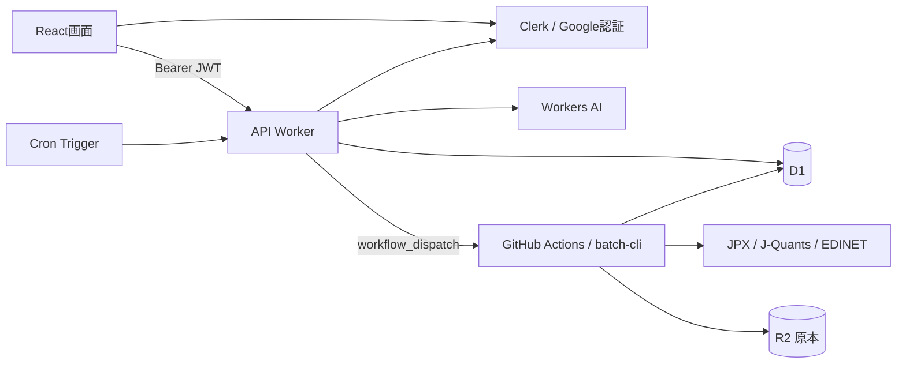

# 03 システム構成

## 構成要素

| 実装 | 役割 |
|---|---|
| `crates/domain` | 指標・配当方針・銘柄コード・権限・ランキングなど、外部基盤に依存しない計算 |
| `crates/usecase` | 認証、検索、ポートフォリオ、AI生成、テーマ、日次計算の処理と入出力ポート |
| `crates/adapter-cf` | D1、Clerk JWT検証・ユーザー取得、Workers AI、GitHub起動 |
| `crates/api-worker` | HTTPルーティング、認可、JSON変換、キャッシュ、Cron処理 |
| `crates/adapter-batch` | 外部データ取得・解析、D1 HTTPアクセス |
| `crates/batch-cli` | GitHub Actionsで動くネイティブCLI |
| `web` | React・TypeScript・Vite、Tailwind、RadixベースのUI、SVGグラフ |

## 配置とバインディング

[wrangler.jsonc](../wrangler.jsonc)がWorker配置の設定元。

| 項目 | 設定 |
|---|---|
| Worker | `maaun-stock-insight` |
| 公開ドメイン | `stock.insight.maa-un.com` |
| Workerエントリ | `crates/api-worker/build/index.js`（worker-buildで生成） |
| 静的アセット | `web/dist`、SPA fallback、`/api/*` はWorkerを先に実行 |
| D1 | binding `DB`、database `maaun-stock-insight` |
| AI | binding `AI` |
| R2 | バッチの原本保存先 `maaun-stock-insight-raw`。API WorkerにはR2 bindingなし |
| 開発用ドメイン | `workers_dev=false`、バージョンプレビューは有効 |
| ログ | Worker observability有効 |

## 定期処理

| 起動元 | UTC | JST | 処理 |
|---|---|---|---|
| Worker Cron | 平日09:30 | 平日18:30 | `daily-batch` をmainに対して起動 |
| GitHub schedule | 平日09:45 | 平日18:45 | 日次取得の予備起動 |
| Worker Cron | 平日12:00 | 平日21:00 | 条件を満たす日のAIレコメンド生成 |

祝日・実行済みの判定は日次バッチ側で行う。AI側は最新バッチの状態・終了日・既存結果を確認する。[バッチ運用](13_batch_operations.md)と[AI仕様](12_recommendations_and_themes.md)を参照。

Cloudflare Workflows、メール送信、Clerk Webhookは構成に含まれない。CIとタグのRelease処理から本番への自動デプロイは行わない。
