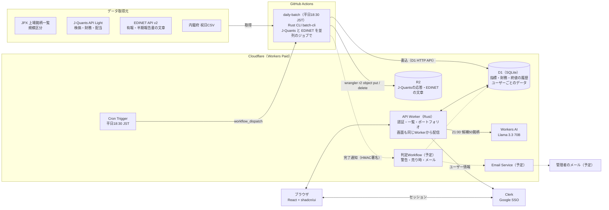

# 03 システム構成図

> 出典: Claude Docs「増配期待株ダッシュボード 要件定義」（rev 56, 2026-10-21）。その後の実装（v0.3.0 まで）に合わせて更新

## 方針

バッチをCloudflareだけで作ることもできるが、作り始めた無料プランでは1回の実行がCPU 10msまでで、全銘柄の取り込みや有報の解析が収まらなかった。そこで「取得と整形はGitHub Actions上のRust CLI、配信・判定・AI・通知はCloudflare」に分ける構成にした。2026-10-22 に Workers Paid（月$5）にしたが、バッチは GitHub Actions のまま（公開リポジトリで費用がかからず、6時間まで動かせる）。

## 全体構成

取得はGitHub Actions、配信と判定はCloudflareで行う。点線は未実装（予定）。

日次バッチが取り込みと指標計算を終えてD1とR2に書き込む。画面側のAPI WorkerはD1を読む（書くのはユーザー・ログイン記録・ポートフォリオと、21:00 の Cron で作る AIレコメンドだけ）。判定Workflowは未実装。

## コンポーネントの役割

| コンポーネント | 実行基盤 | 役割 | 対応する機能 | 状態 |
|---|---|---|---|---|
| ブラウザ（SPA） | API Workerの静的アセットから配信 | ログイン、スクリーニング一覧、ポートフォリオ、AIレコメンド、配当方針の文の表示。将来は詳細・条件・通知履歴・管理画面 | F1〜F8 | 一部 |
| API Worker | Cloudflare Workers（Rust / workers-rs） | セッショントークンの検証、許可リストの確認、D1の読み書き。Cron Trigger で日次バッチの起動（18:30）と AIレコメンドの作成（21:00） | F1〜F4, F7, F8 | 済み |
| Cron Trigger | Cloudflare Workers | 平日18:30 JST（`30 9 * * 1-5`）にGitHubの`workflow_dispatch`を呼ぶ。平日21:00 JST（`0 12 * * 1-5`）に AIレコメンドを作る | 日次バッチの起動、F7 | 済み |
| 日次バッチ（batch-cli） | GitHub Actions（Rust / tokio） | JPX・J-Quants・EDINETから取得、指標計算、D1への書き込み、R2に置くファイルの書き出し | データ要件 | 済み |
| 判定Workflow | Cloudflare Workflows | 警告・売り時の判定、通知の作成、管理者へのメール | F4〜F6 | 未実装 |
| D1 | Cloudflare D1 | 銘柄マスタ、最新の指標、年次・四半期の財務、終値の履歴、EDINETの手がかり、ユーザーごとのデータ | 全機能 | 済み |
| R2 | Cloudflare R2 | J-Quantsの応答の全項目（`jquants/`、日付ごと）と、EDINETの文章（`edinet/`、銘柄・種類ごと）。Workerからは読まない | データ要件 | 済み |
| Workers AI | Cloudflare Workers AI（`wrangler.jsonc` の `ai` バインディング） | 候補50銘柄から上位10銘柄を選び、理由を書く | F7 | 済み |
| Clerk | 外部SaaS（PropFolio・area-insightと共用） | Google SSO、セッション、ユーザー情報（Googleのつながり・`public_metadata`） | F1 | 済み |
| Email Service | Cloudflare Email Service | 検証済みの管理者アドレスへのメール送信 | F6 | 未実装 |

## バッチをどこで動かすか

| 案 | 構成 | 費用 | 判断 |
|---|---|---|---|
| A ハイブリッド（採用） | Cloudflare の Cron Trigger が GitHub Actions の `workflow_dispatch` を呼び、Rust CLI を実行。J-Quants と EDINET は別のジョブで並列。D1はHTTP API、R2は`wrangler r2 object put`で書き込む。将来は最後にWorkerの内部エンドポイントを叩いて判定Workflowを起動 | 0円。公開リポジトリはGitHub標準のランナーが無料 | CPU制限がなく、バッチも同じRustのドメインを使える |
| B Cloudflareだけ | Cron Trigger → Workflows。1銘柄1ステップ、約4インスタンスに分割 | 0円 | 株価取得は可能。有報の解析が1ステップ10msに収まるかは不明 |
| C Workers有料プラン | Bと同じ。CPU上限が大幅に増え、メールも任意の宛先に送れる | 月$5 | 2026-10-22 にプランは Paid にした。バッチを移すかは未定（今は A のまま） |

## 日次の処理タイムライン

| 時刻（JST, 平日） | 処理 | 実行基盤 |
|---|---|---|
| 18:30 | Cron Triggerが`workflow_dispatch`を呼び、日次バッチを起動 | Cloudflare → GitHub Actions |
| 18:45 | 予備の`schedule`。起動済みなら`should-run`が止める | GitHub Actions |
| 18:30〜19:30 | `prepare`（`migrate` → `sync-master`）のあと、`jquants`（`sync-jq` → `compute` → R2）と `edinet`（`sync-edinet` → R2）を並列に実行 | GitHub Actions |
| 19:30〜20:30 | 判定Workflow: 警告・売り時の判定、画面通知、管理者メール | Cloudflare Workflows（未実装） |
| 21:00 | AIレコメンド: その日のバッチが成功していて、まだ結果がなければ作る | Cloudflare Workers（Cron Trigger） |

休業日（土日・祝日・12/31〜1/3）と、その日にすでに成功しているときは`batch-cli should-run`が止める。

## インフラ管理とデプロイ

リソースは当面、wranglerコマンドで作成してCloudflare側で管理する。あとで[maaun-terraform](https://github.com/maa-un/maaun-terraform)にimportできるよう、名前は`maaun-`で始め、作成したリソースはこの表に記録する。デプロイとシークレットの登録もコマンド（wrangler・gh）で行う。

### 作成済みのリソース

| 種類 | 名前 | 作成方法 | 作成日 |
|---|---|---|---|
| D1 | `maaun-stock-insight`（APAC） | `wrangler d1 create maaun-stock-insight --location apac` | 2026-10-21 |
| R2 | `maaun-stock-insight-raw`（APAC） | `wrangler r2 bucket create maaun-stock-insight-raw --location apac` | 2026-10-21 |
| Worker | `maaun-stock-insight`（Cron Trigger `30 9 * * 1-5`・`0 12 * * 1-5`、Workers AI のバインディングつき） | `wrangler deploy`（[07](07_deploy.md)） | 2026-10-21 |
| カスタムドメイン | `stock.insight.maa-un.com` | `wrangler.jsonc` の `routes`（`custom_domain: true`） | 2026-10-21 |

IDは`wrangler d1 info` / `wrangler r2 bucket info`で確認できる（秘密ではないが、GitHub Actionsへは`gh secret set`で渡す）。リポジトリは個人アカウントの `taaaaakahiro/stock-insight`（maaun-terraform の GitHub 管理は maa-un 組織だけなので対象外）。

### 管理方法

| 対象 | 管理方法 |
|---|---|
| D1、R2、カスタムドメイン、Cron Trigger | wranglerで作成。将来Terraformにimportする可能性あり |
| Workerのコードと紐付け（D1、Workers AI、静的アセット、Cron Trigger、vars） | `wrangler.jsonc`に定義し、`wrangler deploy`で反映。R2・Workflows の紐付けは使うときに足す |
| デプロイ | 承認フローに沿って手で`wrangler deploy`（[07](07_deploy.md)）。確認は`wrangler versions upload`のプレビューURL。CI からの自動デプロイは未設定 |
| D1のテーブル定義の変更 | `migrations/`にSQLを置き、`batch-cli migrate`（D1 HTTP API）で適用。日次バッチが毎回最初に実行する |
| R2 のファイル | 日次バッチのワークフローが`wrangler r2 object put` / `delete`で置く・消す |
| Cloudflare APIトークン | ダッシュボードで発行（権限は用途ごとに最小）。値は`gh secret set`に直接入力 |
| Worker Secret / GitHub Actions Secrets / Variables | `wrangler secret put` / `gh secret set` / `gh variable set`（値は標準入力から渡す） |

- 本番への変更（リソースの作成・削除、スキーマの適用、デプロイ）は、実行前に人が承認する
- 切り戻しは`wrangler rollback`で直前のバージョンに戻す

## ネットワークとドメイン

| 項目 | 内容 |
|---|---|
| ドメイン | stock.insight.maa-un.com（Workerのカスタムドメイン）。`workers.dev` は無効、プレビューURLは有効 |
| 画面とAPI | 同じオリジンから配信。静的アセットを返し、`/api/*` だけ Worker を通す（`run_worker_first`） |
| 認証 | Clerk（`https://clerk.maa-un.com`。PropFolioと同じルートドメインのサブドメイン間でセッションを共有） |
| 通信 | HTTPSのみ、HSTS有効 |
