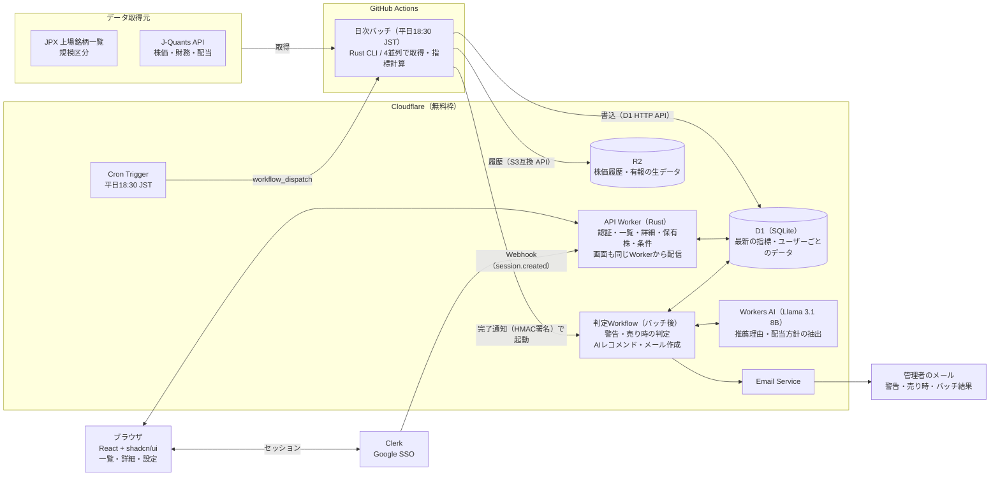

# 03 システム構成図

> 出典: Claude Docs「増配期待株ダッシュボード 要件定義」（rev 56, 2026-10-21）

## 方針

バッチをCloudflareだけで作ることもできるが、無料プランでは1回の実行がCPU 10msまでで、有報の解析が収まらない恐れがある。そこで「取得と整形はGitHub Actions上のRust CLI、配信・判定・AI・通知はCloudflare」に分ける構成を推奨する。

[embed: 全体構成 · 日次バッチ → D1/R2 → 判定Workflow → メール]

日次バッチが取得と指標計算を終えてD1とR2に書き込み、完了後に判定Workflowが警告・売り時・AIレコメンドを作ってメールを送る。画面側のAPI WorkerはD1を読むだけ。

## 全体構成

取得はGitHub Actions、配信と判定はCloudflareで行う。

日次バッチが取得と指標計算を終えてD1とR2に書き込み、完了後に判定Workflowが警告・売り時・AIレコメンドを作ってメールを送る。画面側のAPI WorkerはD1を読むだけ。

## コンポーネントの役割

| コンポーネント | 実行基盤 | 役割 | 対応する機能 |
|---|---|---|---|
| ブラウザ（SPA） | API Workerから配信 | 一覧・詳細・保有株・売り時条件・AIのおすすめ・通知履歴・ログイン記録の表示 | F1〜F8 |
| API Worker | Cloudflare Workers（Rust / workers-rs） | セッショントークンの検証、許可リストの確認、D1の読み書き、Clerk Webhookの受信、内部エンドポイント | F1〜F6, F8 |
| Cron Trigger | Cloudflare Workers | 平日18:30 JSTにGitHubの`workflow_dispatch`を呼ぶ | 日次バッチの起動 |
| 日次バッチ（batch-cli） | GitHub Actions（Rust / tokio） | JPX・J-Quantsから取得、指標計算、D1への書き込み | データ要件 |
| 判定Workflow | Cloudflare Workflows | 警告・売り時の判定、AIレコメンド、通知の作成、管理者へのメール | F4〜F7 |
| D1 | Cloudflare D1 | 最新の指標、年次財務、ユーザーごとのデータ | 全機能 |
| R2 | Cloudflare R2 | （予備）今は未使用。株価の履歴はD1の price_history に1銘柄1行で持つ | — |
| Workers AI | Cloudflare Workers AI | おすすめ銘柄の理由づけ、配当方針の抽出 | F3, F4, F7 |
| Clerk | 外部SaaS（PropFolioと共用） | Google SSO、セッション、ログインのWebhook | F1 |
| Email Service | Cloudflare Email Service | 検証済みの管理者アドレスへのメール送信 | F6 |

## バッチをどこで動かすか

| 案 | 構成 | 費用 | 判断 |
|---|---|---|---|
| A ハイブリッド（推奨） | GitHub ActionsのCron（平日18:30 JST）でRust CLIを実行。D1はHTTP API、R2はS3互換 APIで書き込み、最後にWorkerの内部エンドポイントを叩いて判定Workflowを起動 | 0円。公開リポジトリはGitHub標準のランナーが無料（要確認） | CPU制限がなく、バッチも同じRustのドメインを使える |
| B Cloudflareだけ | Cron Trigger → Workflows。1銘柄1ステップ、約4インスタンスに分割 | 0円 | 株価取得は可能。有報の解析が1ステップ10msに収まるかは技術検証が必要 |
| C Workers有料プラン | Bと同じ。CPU上限が大幅に増え、メールも任意の宛先に送れる | 月$5 | 無料でなくてよいなら一番すっきりする |

## 日次の処理タイムライン

| 時刻（JST, 平日） | 処理 | 実行基盤 |
|---|---|---|
| 18:30 | Cron Triggerが`workflow_dispatch`を呼び、日次バッチを起動 | Cloudflare → GitHub Actions |
| 18:30〜19:30 | 4ジョブで取得・指標計算、D1・R2へ書き込み、集約ジョブでパーセンタイル確定 | GitHub Actions |
| 19:30〜20:30 | 判定Workflow: 警告・売り時の判定、AIレコメンド、画面通知、管理者メール | Cloudflare Workflows |

休業日（土日祝・年末年始）はバッチを実行しない。

## インフラ管理とデプロイ

リソースは当面、wranglerコマンドで作成してCloudflare側で管理する。あとで[maaun-terraform](https://github.com/maa-un/maaun-terraform)にimportできるよう、名前は`maaun-`で始め、作成したリソースはこの表に記録する。デプロイとシークレットの登録もコマンド（wrangler・gh）で行う。

### 作成済みのリソース

| 種類 | 名前 | 作成方法 | 作成日 |
|---|---|---|---|
| D1 | `maaun-stock-insight`（APAC） | `wrangler d1 create maaun-stock-insight --location apac` | 2026-10-21 |
| R2 | `maaun-stock-insight-raw`（APAC） | `wrangler r2 bucket create maaun-stock-insight-raw --location apac` | 2026-10-21 |

IDは`wrangler d1 info` / `wrangler r2 bucket info`で確認できる（秘密ではないが、GitHub Actionsへは`gh secret set`で渡す）。

### 管理方法

| 対象 | 管理方法 |
|---|---|
| D1、R2、カスタムドメイン、Cron Trigger | wranglerで作成。将来Terraformにimportする可能性あり |
| Workerのコードと紐付け（D1、R2、Workers AI、Workflows） | `wrangler.jsonc`に定義し、`wrangler deploy`で反映 |
| デプロイ | mainへのマージでGitHub Actionsが`wrangler deploy`。プルリクエストでは`wrangler versions upload`でプレビューURL |
| D1のテーブル定義の変更 | `migrations/`にSQLを置き、`batch-cli migrate`（D1 HTTP API）で適用 |
| Cloudflare APIトークン | ダッシュボードで発行（権限は用途ごとに最小）。値は`gh secret set`に直接入力 |
| Worker Secret / GitHub Actions Secrets | `wrangler secret put` / `gh secret set`（値は標準入力から渡す） |

- 本番への変更（リソースの作成・削除、スキーマの適用）は、実行前に人が承認する
- 切り戻しは`wrangler rollback`で直前のバージョンに戻す

## ネットワークとドメイン

| 項目 | 内容 |
|---|---|
| ドメイン | stock.insight.maa-un.com（Workerのカスタムドメイン） |
| 画面とAPI | 同じオリジンから配信（Cookieの扱いを単純にする） |
| 認証 | Clerk（PropFolioと同じルートドメインのサブドメイン間でセッションを共有） |
| 通信 | HTTPSのみ、HSTS有効 |
