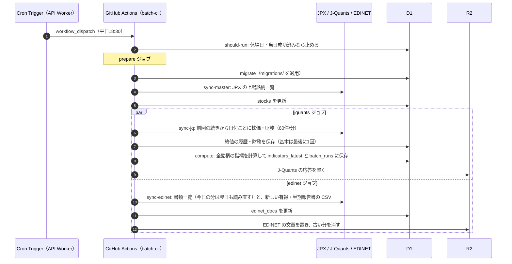
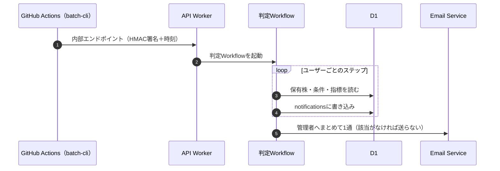
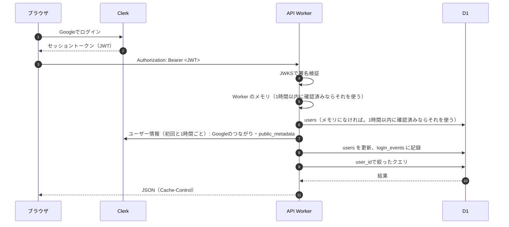
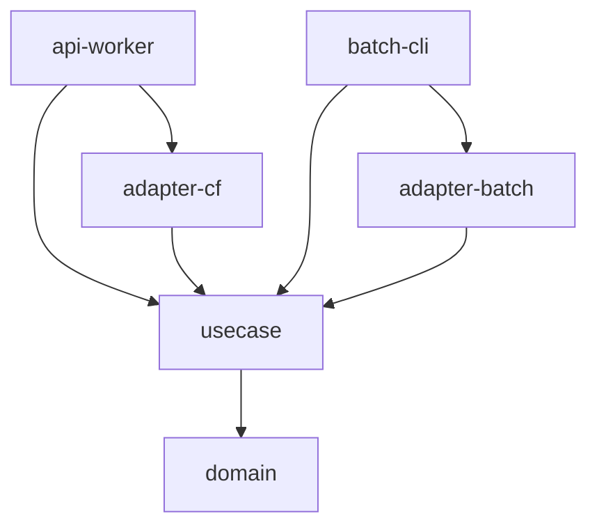

# 04 基本設計

> 出典: Claude Docs「増配期待株ダッシュボード 要件定義」（rev 56, 2026-10-21）。その後の実装（v0.3.0 まで）に合わせて更新

要件は [01 要件定義](01_requirements.md)、構成は [03 システム構成図](03_system_architecture.md) を参照。

## 設計方針

- 画面側では重い計算をしない。指標はバッチで計算して保存し、画面は整形済みの1表を読むだけにする
- 機能は「整形済みデータの表示（API Worker）」と「日次バッチ後の判定・通知（判定Workflow、未実装）」の2つに分ける
- Rustはクリーンアーキテクチャで層ごとにcrateを分け、API Workerとバッチで同じロジック（domain / usecase）を使う
- 外部ライブラリは「ないと実現できないもの」だけにする
- ユーザー固有データは、リポジトリ層で必ず`user_id`を条件に含める

## 処理の流れ

### 日次バッチ（実装済み）

### 日次バッチ後の判定と通知（予定）

### 画面からのリクエスト

## Rust（クリーンアーキテクチャ）

Cargoワークスペースで層ごとにcrateを分け、依存は外側から内側への一方向にする。domainとusecaseはWasmとネイティブの両方でビルドできるようにし、API Workerとバッチで同じロジックを使う。

| crate | 層 | 中身 |
|---|---|---|
| domain | エンティティ | 銘柄・株価・財務のモデル、指標の計算（`indicators.rs`）、5年分の分析（`analysis.rs`）、配当方針の手がかり（`disclosure.rs`）、絞り込み条件の検証（`screening.rs`）、売り時のサイン（`portfolio.rs`）、AIレコメンドの候補選びと答えの検証（`recommend.rs`）、許可の判定（`access.rs`）、営業日（`calendar.rs`）、終値の履歴の形式（`price_history.rs`）、銘柄マスタ（`stock_master.rs`）。外部依存なし |
| usecase | アプリケーション | 本人確認（`auth.rs`）、一覧・状態・配当方針（`screening.rs`）、ポートフォリオ（`portfolio.rs`）、AIレコメンドの作成（`recommend.rs`）、銘柄マスタ・財務・EDINET の取り込み（`master.rs`・`fins.rs`・`edinet.rs`）、日次の指標計算（`daily.rs`）。外部との境界はトレイト（リポジトリ、TokenVerifier、UserDirectory、Clock など） |
| adapter-cf | インフラ（Worker用） | D1 のリポジトリと SQL の組み立て（`query.rs`・`d1_recommend.rs`）、Workers AI への依頼と答えの解析（`ai.rs`・`recommend.rs`）、Clerk のセッショントークンの検証（RS256 を Web Crypto で）とユーザー API、GitHub の `workflow_dispatch` |
| adapter-batch | インフラ（バッチ用） | J-Quants・JPX・EDINET の取得、xlsx と EDINET の CSV（ZIP）の解析、D1 HTTP API、SQL の組み立て、R2 に置く gzip の書き出し |
| api-worker | フレームワーク | workers-rs のルーター、認証、キャッシュ、Cron Trigger（日次バッチの起動と AIレコメンド） |
| batch-cli | フレームワーク | tokio で動く日次バッチの入口（`migrate`・`sync-master`・`sync-jq`・`sync-edinet`・`compute`・`should-run`） |

Wasmでは非同期トレイトにSendが付かないため、ポートはRust標準のトレイト内async fnで定義し、async-trait crateは使わない。

### 依存の向き

## 画面一覧

| ID | 画面 | 主な内容 | 対象 | 対応機能 | 状態 |
|---|---|---|---|---|---|
| S01 | ログイン | Googleのログインボタンのみ。許可リスト外なら「このアカウントは利用できません」 | 全員 | F1 | 済み |
| S02 | スクリーニング一覧 | 株式/REIT/ETFのタブ、左に検索・業種・市場・規模・利回りの過去5年比・バッジ・範囲、右に表。☆でポートフォリオに登録。バッジを押すと配当方針の文。ページ分割（50件）。条件は URL に残す | 全員 | F2, F3, F4 | 済み（名前付きの保存・除外条件は未実装） |
| S03 | 銘柄詳細 | 5年分の業績・配当の推移、四半期単独の損益、配当利回りの推移と過去5年の帯 | 全員 | F3 | 未実装 |
| S04 | ポートフォリオ（保有株） | 登録した銘柄の指標と売り時のサイン。将来は株数・取得単価・評価額・YOC・警告 | 全員 | F4 | 一部 |
| S05 | 売り時条件 | 銘柄ごと／全保有株共通の条件をAND/ORで作成 | 全員 | F5 | 未実装 |
| S06 | AIレコメンド | 最新日の上位10銘柄と理由、指標、使ったモデル、免責表示 | 全員 | F7 | 済み |
| S07 | 通知履歴 | 警告・売り時の通知の一覧 | 全員 | F6 | 未実装 |
| S08 | 設定 | 警告のしきい値、保存した除外条件、保有株と条件のCSV書き出し | 全員 | F2, F4 | 未実装 |
| S09 | ログイン記録（管理） | login_eventsの一覧（拒否された記録を含む） | 管理者 | F1 | 未実装 |
| S10 | バッチ状況（管理） | batch_runs、データ品質チェックの「要確認」一覧、無料枠の使用量 | 管理者 | 運用 | 未実装 |

S02・S04・S06 は同じページのタブで切り替える（URL の `#`）。全画面のヘッダーにデータ鮮度（F8）、フッターに版・免責表示・出典を出す。スマホ（〜md）では一覧をカード表示に切り替える。

## フロントエンド

- React + Vite + TypeScript、UIはshadcn/ui。表・通信・フォームは自前で実装する（下の「依存ライブラリの方針」）
- ドメインはstock.insight.maa-un.com。API Workerと同じオリジン（Workers の静的アセット）から配信する
- セキュリティヘッダーと静的ファイルのキャッシュは `web/public/_headers`
- ローカルでは偽の Clerk（`scripts/mock-clerk.mjs`、`VITE_MOCK_CLERK_URL`）で本物と同じ認証の流れを試せる。本番のビルドは `VITE_CLERK_PUBLISHABLE_KEY` がないと失敗させる

## API一覧

API Workerが提供するエンドポイント。すべて`Authorization: Bearer <セッショントークン>`を必須とする（予定の Webhook と内部エンドポイントを除く）。

### 実装済み

| メソッド | パス | 内容 | キャッシュ | 対応機能 |
|---|---|---|---|---|
| GET | /api/me | ログイン中のユーザー（id・メールアドレス・表示名・管理者かどうか） | no-store | F1 |
| GET | /api/stocks | スクリーニング一覧。クエリは下の表 | 共有（下の注） | F2 |
| GET | /api/stocks/:code/edinet | 有報・半期報告書（最新1通ずつ）から拾った配当方針の手がかりと該当の文 | 共有（下の注） | F3 |
| GET | /api/status | 版（`version`）と直近のバッチ（run_id・開始・終了・状態・最新の株価日付） | 共有（下の注） | F8 |
| GET | /api/portfolio | 登録した銘柄のコード一覧と、各銘柄の一覧と同じ列＋売り時のサイン（`signals`） | no-store | F4 |
| PUT | /api/portfolio/:code | 銘柄を登録（100銘柄まで。超えたら 409） | no-store | F4 |
| DELETE | /api/portfolio/:code | 登録を外す | no-store | F4 |
| GET | /api/recommendations | 最新日の AIレコメンド（日付・モデル・作成時刻と、順位・理由・一覧と同じ列の10行）。まだなければ `day: null` | private, max-age=300 | F7 |

「共有」の3本は中身が誰でも同じなので、データの版をキーに Cache API に置き（24時間）、ブラウザには `private, max-age=300` と弱い ETag を返す（[05 キャッシュ](05_detailed_design.md#キャッシュ)）。D1 の読み取りの無料枠（500万行/日）を画面の操作で使い切らないため。

`/api/stocks` のクエリ:

| キー | 値 |
|---|---|
| `kind` | `stock`（既定）/ `reit` / `etf` |
| `q` | コード（前方一致）または銘柄名（部分一致）。50文字まで |
| `sector` / `market` / `size` | カンマ区切り。市場は `プライム`・`スタンダード`・`グロース`、規模は `large`・`mid`・`small`・`none` |
| `<指標>_min` / `<指標>_max` | `price`, `dividend_yield`, `yield_percentile`, `pbr`, `per`, `payout_ratio`, `doe`, `consecutive_increases`, `operating_margin`, `sales_growth`, `op_growth`。比率は小数（0.03 = 3%） |
| `valuation` | `cheap` / `neutral` / `expensive`（利回りの過去5年比） |
| `no_loss_years` / `profit_uptrend` / `is_value` / `dividend_every_year` / `no_quarterly_loss` / `dividend_policy` | `1` でそのバッジがある銘柄だけ |
| `sort` / `order` | `code` か上の指標名 / `asc`・`desc`（既定は配当利回りの高い順） |
| `page` | 1始まり（50件ずつ） |

### 予定

| メソッド | パス | 内容 | 権限 | 対応機能 |
|---|---|---|---|---|
| GET | /api/stocks/:code | 銘柄詳細（年次・四半期の推移・取得日時） | ユーザー | F3 |
| GET | /api/stocks/:code/yield-history | 配当利回りの推移と過去5年の帯 | ユーザー | F3 |
| GET / PUT | /api/filters | 保存した絞り込み条件と除外条件 | ユーザー | F2 |
| GET / PUT | /api/alert-settings | 警告のしきい値 | ユーザー | F4 |
| GET / POST / PUT / DELETE | /api/sell-rules | 売り時条件 | ユーザー | F5 |
| GET | /api/notifications | 通知履歴 | ユーザー | F6 |
| GET | /api/export/portfolio.csv | ポートフォリオ・保有株と条件のCSV書き出し | ユーザー | 移行性 |
| GET | /api/admin/login-events | ログイン記録 | 管理者 | F1 |
| GET | /api/admin/batch-runs | バッチの実行履歴とデータ品質 | 管理者 | 運用 |
| POST | /webhooks/clerk | Clerk Webhook（session.created）。署名を検証 | Clerk | F1 |
| POST | /internal/batch-completed | バッチ完了通知。HMAC署名と時刻（5分以内）を検証し、判定Workflowを起動 | バッチ | F4〜F7 |

レート制限（1ユーザーあたり60回/分、超えたら429）も予定。

## 主なテーブル（D1）

| テーブル | 中身 | 持ち主 | 状態 |
|---|---|---|---|
| stocks | 銘柄マスタ（名称・種類・市場・業種・規模区分） | 共通 | 済み |
| indicators_latest | 一覧用の最新指標（1銘柄1行、取得日時つき） | 共通 | 済み |
| financials_annual | 本決算の財務と配当 | 共通 | 済み |
| financials_quarterly | 四半期（1Q〜3Q）の期首からの累計値 | 共通 | 済み |
| price_history | 終値の履歴（1銘柄1行） | 共通 | 済み |
| edinet_docs | 有報・半期報告書の配当方針の手がかり（銘柄・種類ごとに最新1通） | 共通 | 済み |
| sync_state | 取り込みの進み具合（どの日付まで取ったか） | 共通 | 済み |
| batch_runs | バッチ（指標計算）の実行履歴 | 共通 | 済み |
| users / login_events | アカウントとログイン記録 | ユーザー | 済み |
| portfolio_items | ポートフォリオに登録した銘柄 | ユーザー | 済み |
| recommendations | 日ごとのAIレコメンド（1日10行） | 共通 | 済み |
| holdings | 保有株（株数・取得単価） | ユーザー | 予定（portfolio_items を広げるか別に作る） |
| sell_rules / alert_settings | 売り時条件、警告のしきい値 | ユーザー | 予定 |
| saved_filters | 保存した絞り込み条件と除外条件 | ユーザー | 予定 |
| notifications | 通知履歴 | ユーザー | 予定 |

列の定義は [05 詳細設計](05_detailed_design.md#テーブル定義) を参照。

## 依存ライブラリの方針

外部ライブラリは「ないと実現できないもの」だけにし、追加するときは理由をREADMEに書く。暗号処理は自作せず、Web Crypto（Workerの標準機能）を使う。

| 分野 | 使う | 使わない（自前で実装） |
|---|---|---|
| Rust共通 | serde、serde_json | async-trait、anyhowなどの便利系（エラー型は自前） |
| API Worker | worker（workers-rs、D1）、web-sys（Web Crypto） | JWTライブラリ（ClerkのRS256検証はWeb Cryptoで実装）、ルーター拡張 |
| バッチ | tokio、reqwest（rustls）、zip（xlsx と EDINET の ZIP）、flate2（R2 に置く gzip） | リトライ・レート制限・xlsx/XML/CSV（TSV）の解析は自前 |
| フロント | React、Vite、Tailwind、shadcn/ui（使う部品だけコピーして取り込む。内部でRadixを使う）、ClerkのReact SDK、lucide-react（アイコン） | TanStack Table / Query（fetchと小さなフックで代替）、Recharts（グラフはSVGで自作する予定）、react-hook-form・zod、日付ライブラリ（Intlで代替） |

shadcn/uiはパッケージではなくソースをリポジトリに取り込む方式なので、使う部品を絞れば依存は増えにくい。shadcnのチャート部品はRechartsに依存するため使わない。
