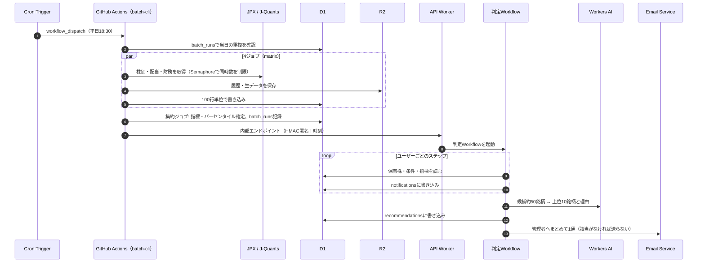
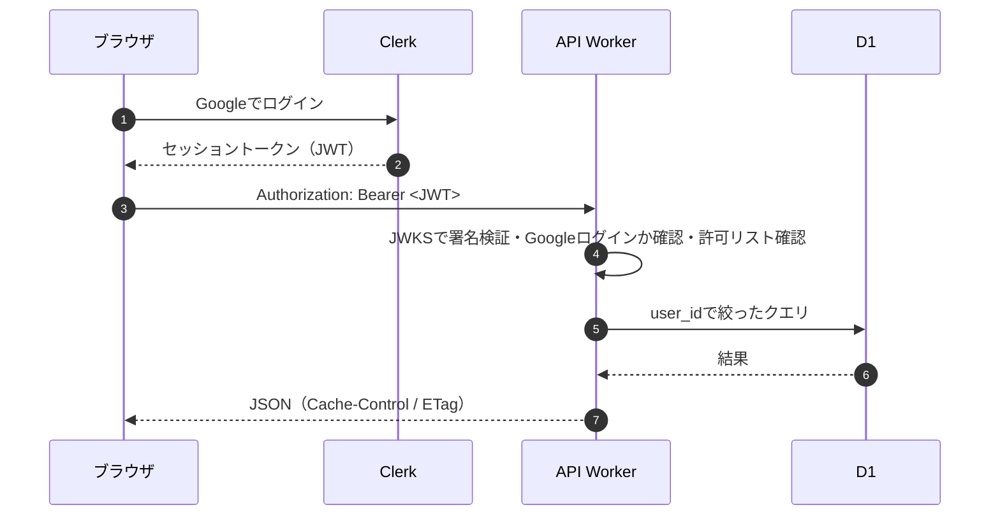
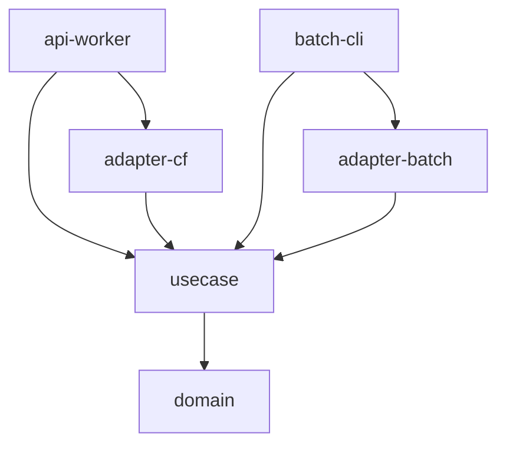

# 04 基本設計

> 出典: Claude Docs「増配期待株ダッシュボード 要件定義」（rev 56, 2026-10-21）

要件は [01 要件定義](01_requirements.md)、構成は [03 システム構成図](03_system_architecture.md) を参照。

## 設計方針

- 画面側では重い計算をしない。指標はバッチで計算して保存し、画面は整形済みの1表を読むだけにする
- 機能は「整形済みデータの表示（API Worker）」と「日次バッチ後の判定・通知（判定Workflow）」の2つに分ける
- Rustはクリーンアーキテクチャで層ごとにcrateを分け、API Workerとバッチで同じ判定ロジック（domain / usecase）を使う
- 外部ライブラリは「ないと実現できないもの」だけにする
- ユーザー固有データは、リポジトリ層で必ず`user_id`を条件に含める

## 処理の流れ

### 日次バッチから通知まで

### 画面からのリクエスト

## Rust（クリーンアーキテクチャ）

Cargoワークスペースで層ごとにcrateを分け、依存は外側から内側への一方向にする。domainとusecaseはWasmとネイティブの両方でビルドできるようにし、API Workerとバッチで同じ判定ロジックを使う。

| crate | 層 | 中身 |
|---|---|---|
| domain | エンティティ | 銘柄、指標、保有株、売り時条件、警告ルール、ユーザー。配当利回りパーセンタイルや警告判定などの純粋関数。外部依存なし |
| usecase | アプリケーション | 銘柄を絞り込む、銘柄詳細を得る、保有株を管理する、条件を評価する、レコメンドを作る、データを取り込む。外部との境界はトレイト（Repository、PriceSource、FinancialSource、Mailer、AiClient、IdentityVerifier、Clock） |
| adapter-cf | インフラ（Worker用） | D1リポジトリ、Workers AI、メール送信、Clerkセッショントークンの検証、Clerk Webhookの署名検証 |
| adapter-batch | インフラ（バッチ用） | J-Quants・JPXの取得とxlsx解析、D1 HTTP API |
| api-worker | フレームワーク | workers-rsのルーター、セッションの確認、判定Workflow |
| batch-cli | フレームワーク | tokioで動く日次バッチの入口 |

Wasmでは非同期トレイトにSendが付かないため、ポートはRust標準のトレイト内async fnで定義し、async-trait crateは使わない。旧方式なら`async_trait(?Send)`相当で定義する。

### 依存の向き

## 画面一覧

| ID | 画面 | 主な内容 | 対象 | 対応機能 |
|---|---|---|---|---|
| S01 | ログイン | Googleのログインボタンのみ | 全員 | F1 |
| S02 | スクリーニング一覧 | 左に範囲スライダーと除外条件、右に表。割安/中立/割高バッジ、規模区分バッジ、保存した条件、ページ分割（50件） | 全員 | F2 |
| S03 | 銘柄詳細 | 10年分の業績・配当の推移、配当利回りの推移と過去レンジの帯、配当方針のAI要約と出典 | 全員 | F3 |
| S04 | 保有株 | 保有株の登録・編集、評価額・YOC、警告の状態 | 全員 | F4 |
| S05 | 売り時条件 | 銘柄ごと／全保有株共通の条件をAND/ORで作成 | 全員 | F5 |
| S06 | AIのおすすめ | 当日の上位10銘柄と理由、免責表示 | 全員 | F7 |
| S07 | 通知履歴 | 警告・売り時の通知の一覧 | 全員 | F6 |
| S08 | 設定 | 警告のしきい値、保存した除外条件、保有株と条件のCSV書き出し | 全員 | F2, F4 |
| S09 | ログイン記録（管理） | login_eventsの一覧（拒否された記録を含む） | 管理者 | F1 |
| S10 | バッチ状況（管理） | batch_runs、データ品質チェックの「要確認」一覧、無料枠の使用量 | 管理者 | 運用 |

全画面のヘッダーにデータ鮮度（F8）、フッターに免責表示を出す。スマホ（360px〜）では一覧をカード表示に切り替える。

## フロントエンド

- React + Vite + TypeScript、UIはshadcn/ui。表・通信・グラフ・フォームは自前で実装する（下の「依存ライブラリの方針」）
- ドメインはstock.insight.maa-un.com。API Workerと同じオリジンから配信し、Cookieの扱いを単純にする
- 画面: ログイン記録（管理者）、スクリーニング一覧（左に範囲スライダーと除外条件、右に表）、銘柄詳細、保有株、売り時条件、AIのおすすめ、通知履歴

## API一覧（案）

API Workerが提供するエンドポイント。すべて`Authorization: Bearer <セッショントークン>`を必須とする（Webhookと内部エンドポイントを除く）。パスは実装時に確定する。

| メソッド | パス | 内容 | 権限 | 対応機能 |
|---|---|---|---|---|
| GET | /api/me | ログイン中のユーザー情報（管理者かどうかを含む） | ユーザー | F1 |
| GET | /api/stocks | スクリーニング一覧（範囲・フラグ・並べ替え・ページ） | ユーザー | F2 |
| GET | /api/stocks/:code | 銘柄詳細（年次推移・配当方針・取得日時） | ユーザー | F3 |
| GET | /api/stocks/:code/yield-history | 配当利回りの推移と過去レンジ（R2から） | ユーザー | F3 |
| GET / PUT | /api/filters | 保存した絞り込み条件と除外条件 | ユーザー | F2 |
| GET / POST / PUT / DELETE | /api/holdings | 保有株 | ユーザー | F4 |
| GET / PUT | /api/alert-settings | 警告のしきい値 | ユーザー | F4 |
| GET / POST / PUT / DELETE | /api/sell-rules | 売り時条件 | ユーザー | F5 |
| GET | /api/notifications | 通知履歴 | ユーザー | F6 |
| GET | /api/recommendations | 当日のAIレコメンド | ユーザー | F7 |
| GET | /api/status | データ鮮度（最新バッチの状態・取得日時） | ユーザー | F8 |
| GET | /api/export/holdings.csv | 保有株と条件のCSV書き出し | ユーザー | 移行性 |
| GET | /api/admin/login-events | ログイン記録 | 管理者 | F1 |
| GET | /api/admin/batch-runs | バッチの実行履歴とデータ品質 | 管理者 | 運用 |
| POST | /webhooks/clerk | Clerk Webhook（session.created）。署名を検証 | Clerk | F1 |
| POST | /internal/batch-completed | バッチ完了通知。HMAC署名と時刻（5分以内）を検証し、判定Workflowを起動 | バッチ | F4〜F7 |

レート制限は1ユーザーあたり60回/分（超えたら429）。

## 主なテーブル（D1）

| テーブル | 中身 | 持ち主 |
|---|---|---|
| stocks | 銘柄マスタ（業種・市場・規模区分） | 共通 |
| indicators_latest | 一覧用の最新指標（1銘柄1行、取得日時つき） | 共通 |
| financials_annual | 年次の財務と配当 | 共通 |
| dividend_policies | AIが抽出した配当方針と出典 | 共通 |
| recommendations | 日ごとのAIレコメンド | 共通 |
| batch_runs | バッチの実行履歴 | 共通 |
| users / login_events | アカウントとログイン記録 | ユーザー |
| holdings | 保有株 | ユーザー |
| sell_rules / alert_settings | 売り時条件、警告のしきい値 | ユーザー |
| saved_filters | 保存した絞り込み条件と除外条件 | ユーザー |
| notifications | 通知履歴 | ユーザー |

列の定義は [05 詳細設計](05_detailed_design.md#テーブル定義案) を参照。

## 依存ライブラリの方針

外部ライブラリは「ないと実現できないもの」だけにし、追加するときは理由をREADMEに書く。暗号処理は自作せず、Web Crypto（Workerの標準機能）を使う。

| 分野 | 使う | 使わない（自前で実装） |
|---|---|---|
| Rust共通 | serde、serde_json | async-trait、anyhowなどの便利系（エラー型は自前のenum） |
| API Worker | worker（workers-rs） | JWTライブラリ（ClerkのRS256検証とWebhookのHMAC検証はWeb Cryptoで実装）、ルーター拡張 |
| バッチ | tokio、reqwest、zip、quick-xml（XBRL） | リトライ・レート制限・CSV解析は自前 |
| フロント | React、Vite、Tailwind、shadcn/ui（使う部品だけコピーして取り込む。内部でRadixを使う）、ClerkのReact SDK | TanStack Table / Query（fetchと小さなフックで代替）、Recharts（配当利回りの推移はSVGで自作）、react-hook-form・zod（フォームは標準のformと自前の入力チェック）、日付ライブラリ（Intlで代替） |

shadcn/uiはパッケージではなくソースをリポジトリに取り込む方式なので、使う部品を絞れば依存は増えにくい。shadcnのチャート部品はRechartsに依存するため使わない。
