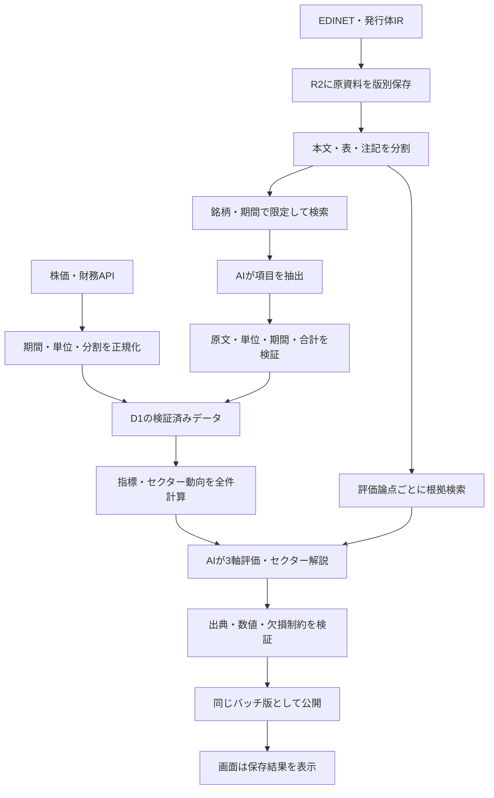

# 12 REIT バッチRAG設計

作成: 2026-10-26。状態: 初版をローカル実装済み・未デプロイ。実装範囲と残課題は第12節を参照。対象は[11 REITの3軸評価](11_reit_evaluation.md)のデータ整形・AI評価・セクター解説。ユーザーの指定により、AI処理はデータ取得後のバッチで行い、画面は保存済みの結果を読む。

## 1. 設計の決定

RAGを「必要な原資料を探し、その根拠に基づいて情報を抽出・評価する処理」として構成する。
**構造化数値の経路と、資料検索の経路を合流させる方式**を採用する。株価・分配金・財務の全件集計はSQL/Rustで行い、意味検索の上位数件からセクター平均を計算しない。

AIは2段階で使う。

1. 抽出: 原資料から分配金の一時要因、固定金利の注記、NAV構成要素などを、出典付きの候補データにする。
2. 判断: 検証済みの数値、セクター全件集計、検索した根拠を使い、3軸評価とセクター解説を作る。

抽出結果が検証される前に評価へ流れないよう、段階を明確に分ける。検索・抽出・判断のどこで情報が不足したかを区別する。



## 2. 基盤と責務

| 担当 | 採用案 |
|---|---|
| 取得・解析・計算・実行制御 | 既存GitHub Actions上のRust batch-cliを拡張。新しい定刻Cronではなく取得完了への依存で実行 |
| 原資料・抽出本文・プロンプト入出力 | 既存R2バケットに新しいrag/プレフィックス。内容ハッシュで不変保存 |
| 文書台帳・検証済み数値・評価・公開版 | 既存D1。出典との関連を保持 |
| 語句検索 | D1 FTS5。日本語はバッチで分かち書きし、検索クエリにも同一の処理を適用 |
| 意味検索 | Cloudflare Vectorizeを追加。日本語資料で検証した多言語埋め込みモデルを使用 |
| 抽出・評価のAI | Workers AIのREST呼び出しをバッチから実行する案。抽出と評価は別プロンプト・別モデル設定 |
| 画面/API | D1の公開版のみ参照。出典抜粋は既存認可の下で返す。画面から推論を起動しない |

Vectorizeは検索補助であり、文書の有効性やアクセス権の正本はD1。モデル名・次元数・トークン上限・価格は実装時に公式仕様と日本語評価結果で確定する。既存の株式推薦モデルを無検証で流用しない。

## 3. 取得と資料の版管理

### 初期の情報源

- J-Quants: 株価・分配金・財務。既存の構造化取得を利用。
- EDINET: 有報と訂正有報を優先。REITのiXBRL本文・表・注記を取得する。
- 発行体IR: 決算説明資料・分配金予想修正等。不足項目の補完に限り、銘柄別の公式ドメインと資料一覧を登録して取り込む。
- セクター背景: 初版は取得済みの発行体開示を中心にする。金利・不動産市況等は公式統計や公開調査の取得元を別途登録してから追加する。推論中の自由なWeb探索は行わない。

現行のedinet/以下は銘柄・資料種別ごとに上書きされるため、RAGはそのキーを履歴として使わない。新しい経路では原本を先に保存する。

`rag/documents/{source}/{external_id}/{content_hash}/original`
`rag/parsed/{document_version_id}/{parser_version}/content.json.gz`
`rag/runs/{run_id}/input.json.gz` と `output.json.gz`

同一URLでも内容ハッシュが変われば新しい版。同じ本文が別URLにあっても取得履歴と出典は残し、埋め込みだけ再利用可能にする。
document_versionにはissuer_id、code、document_type、period_start/end、published_at、first_seen_at、fetched_at、hash、URL、訂正元、撤回・置換のイベントを保持する。

**時点を2種類持つ。** 公表時点で何を知り得たかと、アプリが実際にいつ取得・利用できたかを分ける。本番runは公表済みかつスナップショット確定前に取得・索引化済みの版だけを使用する。過去評価も当時の入力を固定保存する。後から取得した過去資料による研究用再構成は本番履歴とは別扱い。
訂正は公表後に旧版を置き換え、過去runの証拠は残す。訂正の対象範囲が特定できない場合は新旧を競合として扱い、その指標は保留。現行EDINET取得が訂正を除外する仕様はRAG用に拡張が必要。

## 4. チャンク設計

- 単位は見出し配下の段落、表とその注記。初期目安はモデルのトークナイザーで400〜800トークン、文章の重なりは最大80トークン。実際の上限は採用モデルに合わせる。
- 表はタイトル・行見出し・列見出し・単位・対象期・脚注を一緒に保存。大きい表を行群に分けても見出しと脚注を引き継ぐ。数字だけのチャンクを作らない。
- 検索対象の小チャンクと、生成に渡す親節を分ける。隣接する注記を展開できるparent_idと順序を保持する。
- 各チャンクに原文位置（HTML要素/テキスト範囲、またはページ・表・行）を付ける。PDF/OCRは座標と読み取り品質も保持する。ページの概念がないHTMLにページ番号を捏造しない。
- chunk_idは文書版・解析版・位置・本文ハッシュから生成。数値は原表記と正規化値を両方保持する。
- AI生成要約・前回AI評価を一次資料の索引に混ぜない。原資料の主張とAIの推測の循環を防ぐ。

PDF/OCRの実装時は対象スキルに従って別途精度検証する。抽出値と表構造が信頼できないスキャンは未検証として保存する。

## 5. 検索パイプライン

### 抽出用

必要項目ごとに検索テンプレートを用意する。例: 固定・変動・金利スワップ、分配金・売却益・内部留保・利益超過分配、純資産・鑑定評価額・帳簿価額・発行済投資口数。

1. D1で銘柄、対象期、書類種別、基準日時、訂正関係、アクセス範囲から有効文書を確定。
2. XBRLタグや表見出しで直接取得できる項目はその経路を優先。該当する表・注記は類似度に関係なく根拠候補に含める。
3. 語句検索と意味検索をそれぞれ実行。初期候補数は各20件、重複除去後に順位融合（RRF、初期k=60）。銘柄コード・期・単位の一致を優先する。
4. D1の有効文書集合で再検証してから、親節と必要な注記を展開。重要論点ごとに根拠を確保し、初期目安6〜12チャンクを入力上限内で渡す。
5. 必須項目が見つからなければ文書内の表・見出しを対象に検索を1回拡張。それでもなければmissing。検索失敗を「該当事実なし」と扱わない。

Vectorize側はissuer_id、document_type、published_at等で事前に絞り、必要なmetadata indexを投入前に作成する。利用可能なフィルター数等は実装時に確認する。細かい訂正・権限の判定はD1で必ず行う。後段除外で候補不足なら文書別検索へ切り替え、無関係な他社資料で埋めない。
埋め込みモデルを変更したら新しいindex_versionで全件再生成する。旧・新のベクトルを混在させない。登録受付と検索可能になる時点を区別し、必要な文書が検索可能か確認してからそのindex_versionを公開する。

### 評価用

3軸ごとの論点（分配の持続性、借換え、NAV・価格比較）で検索する。抽出に使った根拠は必ず含め、異なる説明や懸念を述べる箇所も検索する。新しい資料だけに偏らず、比較に必要な同一定義の過去期を取得する。
セクターは全銘柄の検証済み数値を集計し、上昇・下落・不変・欠損の件数をAIへ渡す。文章の根拠は銘柄別・論点別に選び、一社の資料が候補を占めないよう上限を設ける。少数社の記述からセクター全体の原因を断定しない。

## 6. 抽出契約と検証

AI抽出は候補として次の形式で返す。値のない項目はnullと理由を返す。

```json
{
  "metric_key": "fixed_rate_ratio",
  "value_raw": "82.5％",
  "value_normalized": 0.825,
  "unit": "ratio",
  "period_end": "2026-06-30",
  "basis": "including_interest_rate_swaps",
  "evidence": [{"chunk_id": "example", "quote": "固定金利比率 82.5％"}],
  "status": "candidate"
}
```

上記は架空例。期間、比率の分母、含む範囲も根拠に結び付ける。原資料で定義不明ならbasisを推定してverifiedにしない。

検証は、スキーマ、原文引用の実在、銘柄・対象期、円/千円/百万円、%/小数、分配金の半年/年間、分割基準、総額の一致、重複、既存の構造化値との照合を順に行う。引用の一致だけでは意味の正しさを保証しないので、表の見出し・脚注との対応も条件にする。
同じ定義・対象期なら訂正済みの公式構造化値を優先。会社独自のLTV等、定義の違う値は別指標として保持する。解消できない不一致はconflictとして隔離し、都合のよい方を採用しない。
verifiedのみ11のreit_metric_observationsへ昇格する。candidate / conflict / missingは証拠と一緒に保持し、評価の欠損表示に使う。既存の検証済み値を新しい未検証値で上書きしないが、新規開示の未反映状態は表示する。

## 7. バッチと公開

処理順: `取得 → 原本保存 → 解析・索引 → 抽出・検証 → 数値集計 → 評価用検索 → AI判断 → 出力検証 → 公開`。
銘柄単位の段階ジョブに分割し、job_keyを入力ハッシュ＋処理版＋モデル設定から作る。成功済みは再利用。HTTPの一時失敗は指数バックオフで最大3回、出力修正は最大1回。時間と費用の上限に達したら未完了として翌回再開する。

- 新資料時だけ解析・埋め込み・抽出を行う。日々の価格変更では数値集計と価格に依存する評価を再計算する。
- 同用途の新規開示は比較中央値やセクター評価にも影響する。依存グラフに文書・観測値・セクタースナップショットを記録し、対象銘柄だけでなく依存する評価を無効化する。
- run開始時にデータcutoffと文書集合を固定する。途中で届いた開示は次のrunへ回し、同じrunの中に混ぜない。
- R2/Vectorize/D1間の一括トランザクションは前提にしない。準備済みmanifestの検証後、D1の公開ポインターを条件付きで一括更新する。古いrunが新しい公開版を上書きしない。
- セクター公開版には構成全件の完了・欠損状態を含める。欠損時は11の集計ルールに従い保留にする。一部だけ成功したAI評価を今日の全件結果として扱わない。
- 失敗時は前回公開版を維持し「更新未完了」と基準日を表示。新しい株価を別欄に出す場合も旧AI評価の入力日とは区別する。
- 全件バックフィルは日次処理と分け、チェックポイントから再開可能にする。

## 8. 保存契約

| テーブル案 | 主な情報 |
|---|---|
| rag_document_versions | 原本版、取得・公表日時、出典、ハッシュ、期間、訂正・撤回、アクセス範囲 |
| rag_chunks / rag_chunk_fts | 本文位置、親節、検索用分かち書き、解析・埋め込み版、R2キー |
| rag_extractions | 項目候補、値・定義・期間、状態、検証エラー、抽出run |
| rag_evidence_links | 抽出・評価・主張と文書版/チャンク/引用位置の多対多の関連 |
| rag_retrieval_runs | クエリ版、filters、候補と順位、採用・除外理由、検索時点、index_version |
| rag_batch_runs / rag_jobs | cutoff、入力manifest、処理版、状態、再試行、時間、利用量、費用推計 |
| rag_publications | 公開版ID、旧版ID、公開日時、入力・評価manifest |

11のreit_metric_observations・reit_ai_runs・reit_ai_assessments・セクター各テーブルを再利用し、同じ観測値やAI結果を別の正本として二重保存しない。run_idとevidence_idで接続する。
保持方針: 公開結果が参照する原本・根拠・入出力は削除しない。利用条件で保持できない資料は初めから対象外とする。未公開の失敗runは初期案90日、再生成可能な検索索引は版の切替後に整理可能。削除しても公開評価の再現性を壊さないことを確認する。

## 9. 権限・観測・コスト

現行のデータ利用範囲に従い、管理者向けの結果として提供する。原資料・API応答・AI入力は公開GitHubのログやartifactへ出さず、非公開のR2へ保存する。検索結果・出典のAPIでも認可を行う。
資料の本文は信頼できない入力として扱う。資料に書かれた指示で外部通信・ツール実行・出典変更をさせない。URL取得は登録済みの公式取得先に限定する。APIトークンは専用Secretと最小権限で管理する。

計測項目: 新規/重複文書数、解析失敗、検索ヒット・不足、抽出の検証通過・競合、銘柄/セクター充足率、引用不一致、run遅延、再試行、モデル別入出力トークン、埋め込み量、検索回数、保存量。
費用は「新規チャンクの埋め込み＋検索＋抽出＋日次評価＋保存」で見積もる。まず代表資料の試行で実測し日次上限を設定する。キャッシュ鍵には原資料版・解析版・クエリ版・モデル/プロンプト・入力スナップショットを含める。特定の月額を未計測で保証しない。

## 10. 検証と実装順

### 評価セット

最低30文書・60問を初期目標とし、用途・形式・表の複雑さを分散する。原資料から人手確認した正解値と根拠位置を作り、調整用と最終確認用を銘柄/文書単位で分離する。
ケースには訂正前後、同じURLの更新、期の取り違え、千円/百万円、半年/年間、固定/スワップ、不明値、脚注、OCR不良、他社資料、取得後の公表訂正、資料内の指示を含める。

初期の公開条件案:

- 数値・期間・単位の完全一致率98%以上、正解根拠のRecall@12が95%以上を目標とし、未達の項目は自動公開しない。
- 固定の重要ケースでは、未来資料・他社混入・偽引用・未検証値の採用・権限越境が0件。
- AIの主張が引用資料で裏付けられるかを別途点検。構文検証を通っただけで正しいとしない。
- 同じ入力でルール計算が再現でき、AI結果は同じ生成を再現できなくても当時の入出力を復元できる。
- 数値全件集計と検索経由の文章解釈を別々に検証し、セクター欠損・短期/中期逆方向・権利落ちのケースも確認する。

### 段階導入

1. 文書台帳・不変保存・出典表示を実装。既存の抽出を根拠IDと接続する。
2. 文書・期・見出しで限定する語句検索とAI抽出を代表銘柄で実装し、数値照合を通す。
3. Vectorizeの意味検索を追加し、語句検索単独に対する根拠回収率の改善を確認する。改善がなければ本番検索で有効化しない。
4. 検証済み指標とセクター集計を使ってAI評価を生成し、公開せず並走して確認する。
5. 合格した項目から3軸評価・セクター解説・根拠リンクを公開する。

想定コード境界: domainは定義・数値/品質検証、usecaseは検索/抽出/評価の順序と公開判定、adapter-batchは取得・解析・検索/AI API、adapter-cfは公開結果と認可済み根拠の読み取り、webは表示。マイグレーション・新CLIコマンド・設定変更は実装時に作成する。

## 11. 参照

- [Cloudflare D1 SQL statements](https://developers.cloudflare.com/d1/sql-api/sql-statements/): FTS5対応。日本語の分かち書き品質は本アプリで別途検証する。
- [Vectorize metadata filtering](https://developers.cloudflare.com/vectorize/reference/metadata-filtering/): メタデータによる絞り込みと事前の索引作成。
- [Vectorize query vectors](https://developers.cloudflare.com/vectorize/best-practices/query-vectors/): 検索インターフェース。
- [Workers AI models](https://developers.cloudflare.com/workers-ai/models/): 実装時のモデル選定元。
- 関連: [09 REITの取得](09_reit_debt.md)、[10 評価の追跡](10_recommendation_evaluation.md)、[11 REITの判断とセクター動向](11_reit_evaluation.md)。

## 12. ローカル実装状況（2026-10-26）

初版のコードを追加。本番デプロイ・D1への適用・実APIでの品質評価は未実施。

実装済み:

- `batch-cli reit-rag --max-minutes 110`: 現行REITプロフィールの有報をEDINETから取得し、銘柄を照合してR2へ原本と解析結果を不変保存する。
- D1の文書・チャンク・FTS5、任意のVectorizeによる検索。日本語検索は初版では形態素解析ではなく文字2-gramを使う。文書単位のnamespaceとD1側のID照合で他銘柄を除外する。
- 表・隣接注記を付けたチャンク。AIによる原文抽出、引用完全一致・論点・IDの検証、抽出キャッシュ。数値の自動昇格は行わず、引用の実在確認と財務数値の検証を区別する。
- AIによる3軸の評価とセクター概況。収益・価格は未検証項目があるため懸念/判定保留。借入は、LTV・返済集中・金利見直し範囲の検証がそろった場合に中間/余裕の目安も許容する。
- 現在のセクター構成による等金額参考比較。取引所営業日を既存カレンダーと内閣府祝日でそろえ、分割を調整。21/63/126取引日の全構成銘柄がそろった場合のみ騰落率を算出する。
- 全銘柄・全セクターの成功後に公開ポインターを更新。途中失敗は前回公開を維持し、画面に更新状態を表示する。
- 原文・モデル入力・検証前出力をR2、公開結果をD1へ保存。画面は `GET /api/stocks/:code/reit-assessment` と `GET /api/reit/sectors` で読む。
- REIT詳細の3軸カードと原文引用、一覧のセクター動向と用途の絞り込み。APIは既存ログイン・許可リストの認可内で配信。

初版の制約（設計の残り）:

- 現行 `reit_profile` が採用している有報が取得対象。訂正有報・撤回・書類情報修正・不開示のメタデータを日次追跡し、関連する銘柄は評価保留にする。訂正本文の自動マージ、発行体IR/PDF/OCRの追加取り込み、過去原本の一括バックフィルは未実装。過去runで参照した原本は保存されるが、取得前の過去の情報集合は復元しない。
- 年間分配金・NAVの構成要素の自動抽出と数値昇格は今後の段階。LTVはiXBRLの期末日・円単位・資産負債純資産の合計・既存借入額との一致を検証して算出する。AIが抽出した数値そのものは引用確認にとどめる。
- 月次リバランスの正式な継続指数、用途変更履歴、分配込み系列は未実装。現在の構成による参考比較として明示する。
- 生成モデルはレコメンドと共通の `@cf/meta/llama-3.3-70b-instruct-fp8-fast`。`usecase::ai_config::TEXT_MODEL` を両方から参照する。代表資料による正解セットの実測、検索回収率と日本語判断品質、費用測定は本番有効化前に行う。閾値は前節の目標値であり、達成実績ではない。
- 検索は直近の採用有報に限定する。未取得資料の不存在は主張しない。Vectorize未設定時は語句検索のみ、設定済みで索引が未反映の場合は公開を保留して再実行する。

### 有効化手順

1. 通常の `batch-cli migrate` で `0022_reit_rag.sql` と `0023_reit_rag_facts.sql` を適用し、APIと画面のコードをデプロイする（通常の本番手順に従う）。
2. 生成モデル名の追加設定は不要。レコメンドと同じWorkers AIモデルを使う。RAG全体で最大12チャンク、各チャンク本文900文字＋見出し・隣接注記を入力するため、その実トークン量とモデルの入力上限内に収まることを確認する。意味検索用の埋め込みモデルは生成モデルとは別で、第4項の任意設定となる。
3. 既存 `CLOUDFLARE_API_TOKEN` に対象R2・D1への書き込みとWorkers AIの実行権限があることを確認。EDINETキーも既存Secretを使う。トークンをログへ出さない。
4. 意味検索を使う場合のみ、埋め込みモデルの次元に合うVectorize indexを作成。Variablesに `REIT_RAG_VECTOR_INDEX` と `REIT_RAG_EMBEDDING_MODEL` を設定し、Vectorizeの読み書き権限を追加。モデルを変更するときは別index名を作る。初版は文書単位namespaceで絞るのでmetadata indexは不要。
5. 実資料による確認後、`REIT_RAG_ENABLED=true` を設定。日次workflowの `jquants`・`reit` ジョブが両方成功した後にRAGが動く。推論費用が発生するため、有効化は明示的に行う。
6. 最初のVectorize取り込みは検索反映待ちで失敗する場合がある。その場合は再実行する。文書・抽出キャッシュを使って再開する。現在は処理段階ごとの完全な再開ではなく、評価生成は新しいrunでやり直す。

ローカル実行には上記のSecret相当の環境変数に加えて `REIT_RAG_BUCKET=maaun-stock-insight-raw` が必要。dry-runや日付指定は未対応のため、指定するとエラーにする。秘密を使わない確認は `cargo test -p adapter-batch reit_rag` と `python3 scripts/test_reit_rag.py`。


### 数値検証と訂正監査の追加

- iXBRLの文脈が対象期末を示すこと、通貨単位がJPYであること、実際の数字があることを確認する。値なし・nil・不明な文脈・別通貨・矛盾する定義は採用しない。分割単位/割合の値を資産額へ誤用しない。
- 資産＝負債＋純資産を照合し、有利子負債の各区分を原資料と再照合して総資産LTVを算出。返済予定の総額を負債と照合し、短期借入の二重計上を避ける。金利不明の幅が判定境界をまたぐ場合は良好判定を認めない。
- 欠損をゼロとして補完しないため、期末や通貨の文脈を取得できない書式や明示的なゼロがない資料ではLTVが保留になる。これは取得率の限界として測定する。
- 訂正監査は初回に採用有報の最も古い提出日から開始し、以後は前回の翌日から再開する。当日は翌回も読み直す。土日祝日も一覧を確認し、古い提出日を持つ取下げ・情報修正イベントを捨てない。訂正の親子関係をたどって対象銘柄を保留する。
- 監査イベントは追記保存。訂正撤回後の原本復活やメタデータ修正の自動解決は行わず、対象資料の照合が済むまで保留を維持する。

### 追加検証記録（2026-10-26）

- 借入の内訳の一部（1年以内返済予定の長期借入・投資法人債）が欠損しても、旧プロフィールの合計と一致するとLTVが検証済みになる不具合を再現。全内訳の明示的な数値を必要とするよう修正し、回帰テストを追加した。資料にゼロの明記がない場合も保留になる。
- 合成iXBRLによる結合テストを追加。原文→財務数値抽出→LTV・返済集中・金利見直しの検証→チャンク検索→引用照合→借入評価まで確認。別通貨・期末違い・欠損・未知の内訳タグ、架空引用・別文書IDは採用しないことを確認した。
- `cargo test -p adapter-batch`: 単体47件＋結合3件成功。`cargo clippy -p adapter-batch --all-targets -- -D warnings` 成功。SQLiteの公開・検索テスト4件、画面テスト13件、画面の型チェックも成功。
- GitHubの設定名のみ確認。既存のCloudflare/EDINET用Secretは登録済みだが、ローカル環境にはAPIキーがなく、RAGモデル・埋め込みモデル・インデックス・有効化のVariablesも未設定だった。Secretの値を取り出すことや、本番ジョブの起動・設定変更は行っていない。
- 今回の結合テストは合成資料と固定AI応答による検証であり、実有報での抽出率、実モデルの日本語判断品質、生成文中の事実関係、費用、Cloudflare上の実行成功を証明しない。これらは第12節の有効化手順に従った実データ検証が必要。
